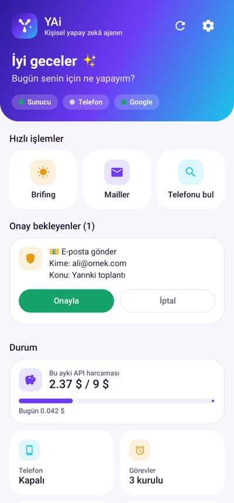
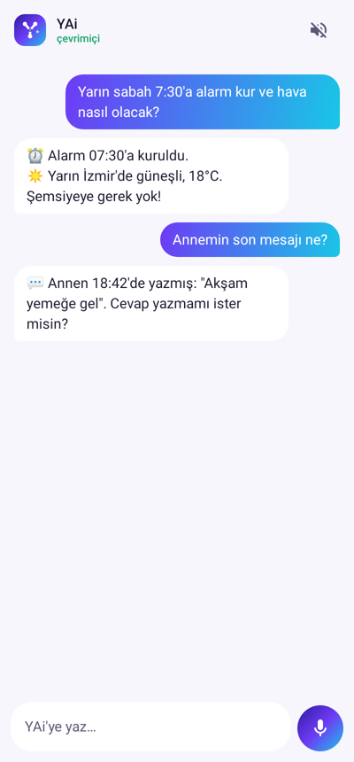
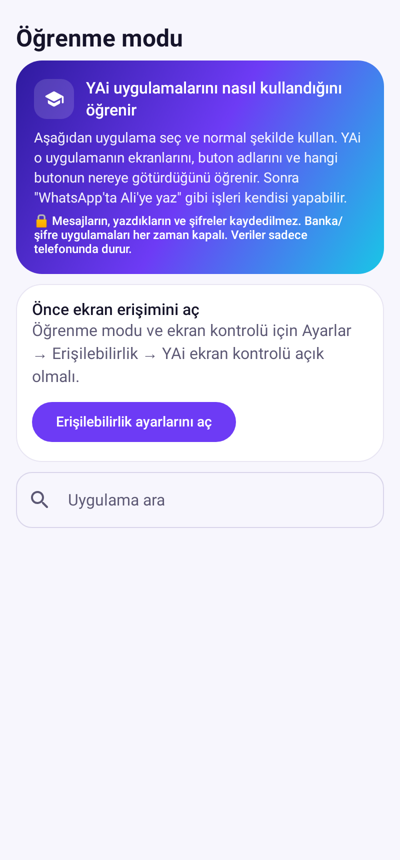
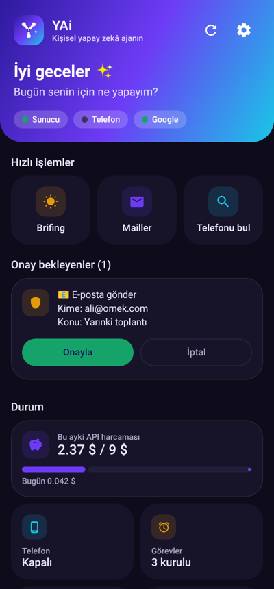

# 🤖 YAi — 7/24 Kişisel Yapay Zekâ Ajanı

> YunUSlu projesinin bir parçası: her şirketin parayla verdiklerini ücretsiz sunma hedefi.

OpenDots, Claude Duet ve Gemini Spark'ın özelliklerini bir araya getiren, **telefonunu da kontrol edebilen**,
Google Gemini ile çalışan ve bulutta 7/24 açık duran kişisel asistan. Aylık **10 $** Google kredisine göre ayarlandı.

## ✨ Özellikler

| Özellik | Nasıl kullanılır |
|---|---|
| 💬 Sohbet (yazı, **sesli mesaj**, fotoğraf, dosya/PDF) | Telegram'dan yaz veya konuş |
| 🔊 Sesli cevap | `/ses ac` |
| ☀️ Sabah brifingi, haftalık özet, tekrarlayan görevler | "Her sabah 8'de bana özet ver" **veya** `/zamanla 08:00 \| Sabah brifingi hazırla` |
| ⏰ Hatırlatıcılar (ücretsiz, yapay zekâ harcamaz) | "Yarın 9'da faturayı hatırlat" veya `/hatirlat yarın 09:00 \| Fatura` |
| 📬 Önemli e-posta uyarısı (proaktif) | Otomatik, her 20 dk'da kontrol |
| 📅 Toplantıdan 15 dk önce uyarı (proaktif) | Otomatik |
| 📧 Gmail: ara, oku, özetle, taslak, **gönder (onaylı)** | "Okunmamış maillerimi özetle" |
| 📅 Takvim, 📁 Drive, 📝 Docs, 📊 Sheets | "Yarın 15:00'e diş hekimi ekle" |
| 🔎 Web arama (Google), sayfa okuma, ☁️ hava durumu | "Bugün dolar ne kadar?" |
| 🤝 Uzman ajanlar (asistan, arastirmaci, operator, yazar + **kendi oluşturdukların**) | `/ajanlar`, "Bana finans ajanı oluştur" |
| 🧠 Kalıcı hafıza | "Ben İzmir'de yaşıyorum, bunu hatırla" — `/hafiza` |
| 🎓 Otomatik öğrenme (tekrarlanan işleri beceriye çevirir, sen onaylarsın) | Otomatik, haftada bir |
| 🌐 Kendi tarayıcısı (siteye girer, tıklar, form doldurur) | "Şu siteye girip fiyatına bak" |
| 💻 Kendi bilgisayarı (dosya + terminal, onaylı) | "Bir Python betiği yaz ve çalıştır" |
| 📄 Sayfalar (rapor/not) | "Bunu rapor olarak kaydet" — `/sayfalar`, panel |
| 🔐 Onay sistemi (✅/❌ butonları) | E-posta/SMS gönderme, arama, silme, terminal, kamera |
| 📊 Web panel (maliyet, onaylar, zamanlayıcılar, hafıza, kayıtlar) | `http://<tailscale-ip>:8080/?token=...` |
| 💸 Bütçe koruması (günlük/aylık limit, uyarılar) | `/maliyet` |
| 📱 **Telefon kontrolü** | Aşağıda |

### 📲 YAi Android uygulaması

<p align="center">
   
   
</p>

Her şeyi telefondan yönetebilmen için yazılmış yerli Android uygulaması (Kotlin + Jetpack Compose, Material 3):

| Sekme | İçerik |
|---|---|
| 🏠 Ana Sayfa | Durum (sunucu, telefon, Google), harcama göstergesi, hızlı işlemler, **onay bekleyen işler** |
| 💬 Sohbet | Yazarak veya 🎤 **konuşarak** YAi ile sohbet. İstersen cevapları sesli okur |
| 📅 Görevler | Zamanlayıcıları ve hatırlatıcıları görme, ekleme, silme |
| 🎓 Öğren | **Öğrenme modu**: YAi'nin hangi uygulamaları öğreneceğini seçme |
| 🧠 Beyin | Hafıza, ajanlar, beceriler, sayfalar |
| ⚙️ Ayarlar | Kurulum kodu, telefon köprüsü, izinler, YAi davranışları |

Uygulama aynı zamanda **telefon köprüsüdür**, Termux'a gerek kalmaz. Ekran kontrolü ADB yerine Android'in
erişilebilirlik hizmetiyle yapılır, kablosuz hata ayıklama gerekmez. Telefon yeniden başlayınca kendisi bağlanır.

### 📱 Telefon kontrolü (Android)

- **Seviye 1:** SMS okuma ve gönderme, arama, arama geçmişi, rehber, bildirimleri okuma, konum, fotoğraf, pano,
  fener, ses seviyesi, sesli okuma, titreşim, "telefonumu bul", link veya uygulama açma, **alarm ve sayaç kurma**.
- **Seviye 2:** Tasker görevleri (Wi-Fi/Bluetooth açıp kapama, rahatsız etmeyin modu, kendi otomasyonların).
- **Seviye 3:** **Ekranı görerek kullanma**. Bot ekrandaki yazıları okur (ucuz) veya ekran görüntüsüne bakar,
  sonra dokunur, kaydırır ve yazar. YAi uygulamasıyla erişilebilirlik hizmeti üzerinden, Termux'la ADB üzerinden çalışır.
  Her oturum için önce senden onay ister.
- **🎓 Öğrenme modu:** Seçtiğin uygulamaların ekranlarını ve gezinme yollarını öğrenir, sonra o uygulamalarda iş yapar.
- **Olaylar:** Pil azalınca uyarı verir. Yeni SMS ve seçtiğin uygulamaların (WhatsApp, Gmail...) bildirimleri Telegram'a gelir.

---

## 🧭 Mimari

```
Telefon (Telegram + Termux köprüsü) ──Tailscale (şifreli)──► Google Cloud e2-micro (ücretsiz)
                                                              ├─ Telegram botu
                                                              ├─ Ajan çekirdeği → Gemini API
                                                              ├─ Zamanlayıcı + proaktif kontroller
                                                              ├─ Web panel + telefon WebSocket
                                                              └─ SQLite (hafıza, görevler, maliyet)
```

---

## 🚀 Kurulum (adım adım)

### Adım 0 — Anahtarları al (10 dk)

1. **Gemini API anahtarı:** <https://aistudio.google.com/apikey> → *Create API key*.
   Kredini kullanmak için anahtarı, faturalandırması açık olan Google Cloud projene bağla.
   (Google AI Pro'nun aylık geliştirici kredisi bu faturalandırma hesabına yansır. Kontrol etmek için:
   Cloud Console → Billing → Credits.)
2. **Bütçe uyarısı kur:** Cloud Console → Billing → *Budgets & alerts* → 10 $ bütçe, %50/%90/%100 uyarısı.
3. **Telegram botu:** Telegram'da **@BotFather** → `/newbot` → isim: `YAi` → verdiği **token**'ı sakla.

### Adım 1 — Ücretsiz sunucuyu oluştur

<https://console.cloud.google.com> → sağ üstte **Cloud Shell** (`>_`) simgesi → şunları çalıştır:

```bash
git clone https://github.com/yunuslu-77/YunUSlu.git && cd YunUSlu
bash deploy/create_vm.sh PROJE_ID        # PROJE_ID: Cloud Console'un üstünde yazar
gcloud compute ssh yai --zone=us-central1-a
```

> Ücretsiz olması için bölge **us-central1 / us-west1 / us-east1**, makine **e2-micro**, disk en fazla **30 GB standard** olmalı.

### Adım 2 — Botu sunucuya kur

Sunucuya bağlandıktan sonra:

```bash
git clone https://github.com/yunuslu-77/YunUSlu.git yai && cd yai
bash deploy/install.sh
nano .env                 # GEMINI_API_KEY ve TELEGRAM_TOKEN'ı yapıştır, Ctrl+O, Enter, Ctrl+X
sudo tailscale up         # çıkan bağlantıyı aç, Google hesabınla giriş yap
tailscale ip -4           # bu IP'yi not al (ör. 100.101.102.103)
sudo systemctl start yai
```

> Repo gizliyse `git clone` için GitHub kullanıcı adı ve bir *personal access token* ister.

### Adım 3 — Kendini sahip olarak tanıt

1. Telegram'da botuna `/start` yaz. Bot sana **kullanıcı ID'ni** söyleyecek.
2. Sunucuda: `nano .env` → `TELEGRAM_OWNER_ID=<ID>` → `sudo systemctl restart yai`
3. Bot "🟢 YAi yeniden başladı" diye yazacak. Artık sadece sana cevap verir.

### Adım 4 — Google hesabını bağla (Gmail, Takvim, Drive)

1. Cloud Console → **APIs & Services → OAuth consent screen**: *External* seç, uygulama adı `YAi` yaz,
   kendi e-postanı *test user* olarak ekle.
   - ⚠️ **Önemli:** "Publishing status" ayarını **In production** yap. Testing modunda bağlantı her 7 günde bir kopar.
     Production'da "doğrulanmamış uygulama" uyarısı çıkar; sadece sen kullandığın için *Gelişmiş → Devam et* diyebilirsin.
2. **Credentials → Create credentials → OAuth client ID → Desktop app** → JSON'u indir.
3. JSON'u sunucuya `data/google_client.json` olarak koy. Cloud Shell'deki SSH penceresinde ⚙️ → *Upload file*
   ile yükleyebilirsin, sonra şunu çalıştır: `mv ~/client_secret_*.json ~/yai/data/google_client.json`
4. Telegram'da `/google` yaz → bağlantıyı aç → izin ver → açılmayan `localhost` sayfasının **adresini kopyalayıp**
   bota gönder. ✅

### Adım 5 — Telefonu bağla: 📲 YAi uygulaması (önerilen)

1. Telefona **Tailscale** uygulamasını kur ve sunucuyla aynı hesapla giriş yap.
2. Sunucuda `.env` dosyasına `PUBLIC_URL=http://<tailscale-ip>:8080` satırını ekle, ardından `sudo systemctl restart yai` çalıştır.
3. **YAi.apk** dosyasını telefona indirip kur ("bilinmeyen kaynaklara izin ver" diye sorarsa izin ver).
   APK'yı GitHub → *Actions* → son derleme → *YAi-apk* bölümünden de indirebilirsin.
4. Telegram'da botuna `/uygulama` yaz. Gelen **kurulum kodunu** kopyala, uygulamayı açıp yapıştır ve **Başla**'ya dokun.
5. Uygulamada **Ayarlar → İzinler** bölümündeki her satıra **Aç** de:
   - Telefon izinleri (SMS, arama, rehber, konum, kamera, mikrofon)
   - **Kısıtlı ayarlara izin ver** (Android 13 ve üstü): *Uygulama bilgisi → ⋮ → Kısıtlı ayarlara izin ver*.
     Telefona dosyadan kurulan uygulamalarda Android bu adımı ister.
   - **Ekran kontrolü ve öğrenme** (Erişilebilirlik → YAi ekran kontrolü)
   - **Bildirim erişimi**, **diğer uygulamaların üzerinde gösterme**, **pil kısıtlamasını kaldırma**
6. Ana sayfada "Telefon: Bağlı" yazısını görmelisin. ✅

#### 🎓 Öğrenme modu
Uygulamada **Öğren** sekmesine gir, YAi'nin öğrenmesini istediğin uygulamaları aç (WhatsApp, YouTube, Spotify...)
ve o uygulamaları her zamanki gibi kullan. YAi şunları öğrenir:
- ekranların adını ve her ekrandaki buton/sekme etiketlerini,
- hangi butona basınca hangi ekrana gidildiğini.

Sonra "WhatsApp'ta Ali'ye 'geliyorum' yaz" dediğinde bu rehbere bakarak adım adım ilerler.
Ekranı kontrol etmeden önce **her seferinde onay ister**.

🔒 **Gizlilik ve güvenlik:**
- Mesaj içerikleri, liste satırları (sohbetler, kişiler), yazdığın metinler ve şifre alanları **kaydedilmez**.
- Öğrenilen veriler sadece telefonunda saklanır.
- Banka, ödeme, kripto, şifre yöneticisi, 2FA ve e-Devlet uygulamaları **her zaman engellidir**: YAi bu
  uygulamalarda öğrenme yapmaz, ekranlarını okumaz, onları açmaz.
- İstediğin uygulamanın öğrendiklerini tek dokunuşla silebilirsin.

#### Alternatif: Termux köprüsü (uygulama kurmak istemezsen)

1. **Tailscale** uygulamasını Play Store'dan kur, sunucuyla aynı hesapla giriş yap.
2. **F-Droid**'den (<https://f-droid.org>) şunları kur: **Termux**, **Termux:API**, **Termux:Boot**.
   Play Store sürümlerini kullanma, eskiler.
3. Termux'u aç ve şunu çalıştır:
   ```bash
   pkg install -y git && git clone https://github.com/yunuslu-77/YunUSlu.git
   bash YunUSlu/phone_bridge/install.sh
   ```
   Sunucu adresi olarak Tailscale IP'sini, PHONE_TOKEN olarak sunucudaki `.env` içindeki değeri gir
   (sunucuda `grep PHONE_TOKEN ~/yai/.env` ile görebilirsin).
4. İzinler:
   - Termux:API'ye SMS, Rehber, Konum, Kamera ve Telefon izinlerini ver.
   - *Ayarlar → Bildirim erişimi* menüsünden **Termux:API**'yi aç.
   - Termux'a **Diğer uygulamaların üzerinde göster** iznini ver (uygulama ve alarm açmak için).
   - Termux, Termux:API ve Termux:Boot'u **pil optimizasyonundan çıkar** (Xiaomi/Samsung'da "otomatik başlatma" iznini de aç).
5. Başlat: `~/yai/start.sh` → Telegram'da `/telefon` yaz, "Bağlı" görmelisin. Telefon yeniden açılınca köprü kendi kendine başlar.

##### Seviye 2 — Tasker (isteğe bağlı)
Tasker'da: *Profil → Olay → Sistem → Intent Received* → Action: `yai.TASKER`
→ Görev: *Perform Task* → Name: `%task`, Parameter 1: `%par`.
Sonra bota "WifiKapat Tasker görevini çalıştır" diyebilirsin.

##### Seviye 3 — Ekranı görerek kullanma (isteğe bağlı)
1. *Ayarlar → Telefon hakkında → Yapım numarası*'na 7 kez dokun. Geliştirici seçenekleri açılır.
2. *Geliştirici seçenekleri → **Kablosuz hata ayıklama*** → aç → *Eşleme kodu ile cihaz eşle*.
3. Ekranı ikiye böl (Termux + ayarlar). Termux'ta:
   ```bash
   adb pair localhost:<eşleme-portu> <6-haneli-kod>
   adb connect localhost:<kablosuz-hata-ayıklama-portu>
   ```
4. Telefon yeniden başlarsa 2. ve 3. adımdaki `adb connect` komutunu tekrar çalıştır (port değişir).

Örnek: "WhatsApp'ı aç ve Ahmet'e 'geliyorum' yaz". Bot önce ekran kontrolü için onay ister, sonra adım adım ilerler.

---

## 💡 Kullanım örnekleri

- "Her sabah 8'de hava durumu, takvimim ve önemli maillerle brifing yap"
- "Hafta içi her gün 18:00'de bana yürüyüşü hatırlat"
- `/zamanla pzt 09:00 | Geçen haftanın maillerinden yapılacaklar listesi çıkar`
- "Annemin son SMS'ini oku", "Ahmet'i ara", "7:30'a alarm kur", "Telefonum nerede?"
- "Gelen faturaları bul ve tutarlarını tabloya ekle"
- "Bana en ucuz İstanbul–Ankara otobüs biletlerini araştır" → arastirmaci ajanı
- 🎤 Sesli mesajla: "Yarın 10'da toplantı ekle ve ekibe davet gönder" → davet için onay ister

## 💸 Maliyet

| Kalem | Model / hizmet | Fiyat (Kasım 2026) |
|---|---|---|
| Günlük işler | `gemini-3.5-flash-lite` | 0,30 $ girdi / 2,50 $ çıktı (1M token) |
| Zor işler (araştırma, ekran) | `gemini-3.8-flash` | 0,75 $ / 3,75 $ (1 Ocak 2027'den itibaren 1,50 $ / 7,50 $) |
| Sesli cevap | `gemini-3.8-flash-lite-tts` | Dakikası yaklaşık 1 sent |
| Google arama | Gemini 3+ | Ayda 5000 arama ücretsiz |
| Sunucu | e2-micro | Always Free kapsamında 0 $ |

- `MONTHLY_LIMIT_USD=9` aşılırsa bot durur ve sana haber verir.
- `DAILY_LIMIT_USD` aşılırsa bot o gün sadece ucuz modeli kullanır.
- Harcama %50, %80 ve %95'e ulaşınca uyarı gelir.
- Fiyatlar değişebilir. Güncel fiyatlar `bot/budget.py` dosyasında, oradan düzenleyebilirsin.

## 🔒 Güvenlik

- Bot **sadece senin** Telegram ID'ne cevap verir.
- Panel ve telefon bağlantısı internete açık değildir. Sadece **Tailscale** üzerinden, uzun rastgele şifrelerle erişilir.
- Telefon köprüsü **sadece izin listesindeki** komutları çalıştırır. Gelen komut kabuğa (shell) verilmez.
- Riskli işler her zaman onay ister. Telefon erişimini `/telefon kapat` veya panelden tek tuşla kesebilirsin.
- Para gönderme, satın alma ve şifre girme işlerini bot kendi başına tamamlamaz.

## 🛠️ Sorun giderme

| Sorun | Çözüm |
|---|---|
| Bot cevap vermiyor | `journalctl -u yai -f` ile logları incele |
| "Telefon bağlı değil" | Telefonda Tailscale açık mı? Termux'ta `~/yai/start.sh` çalıştır, `tail ~/yai/bridge.log` ile logları incele |
| Bildirimler gelmiyor | Termux:API bildirim erişimi açık mı? `PHONE_NOTIFY_APPS` listesine bak |
| Uygulama veya alarm açılmıyor | Termux'a "diğer uygulamaların üzerinde göster" iznini ver |
| Google bağlantısı koptu | OAuth ekranı *In production* olmalı. Sonra `/google yeniden` |
| Bellek yetmiyor | `install.sh` 2 GB swap ekler. Tarayıcıyı az kullan |

## 👩‍💻 Geliştirme

```bash
python3 -m venv .venv && . .venv/bin/activate
pip install -r requirements-dev.txt
python -m pytest -q        # 60 test (telefon köprüsü, ajan, onay, zamanlayıcı, panel, tarayıcı...)
python -m bot.main         # yerelde çalıştır (.env gerekli)
```

Android uygulaması:

```bash
cd android
./gradlew testDebugUnitTest   # testler + ekran görüntüleri (app/build/screens/)
./gradlew assembleRelease     # APK: app/build/outputs/apk/release/app-release.apk
```

Klasörler: `bot/` (sunucu), `bot/tools/` (84 araç), `android/` (YAi uygulaması), `phone_bridge/` (Termux köprüsü),
`deploy/` (kurulum), `tests/`.

> APK şu an hata ayıklama anahtarıyla imzalı. Güncellemeyi eskisinin üzerine kurabilmek için kendi imza anahtarını
> GitHub *Secrets* bölümüne `YAI_KEYSTORE_B64` ve `YAI_KEYSTORE_PASSWORD` olarak ekle. Derleme hattı bu anahtarı otomatik kullanır.
